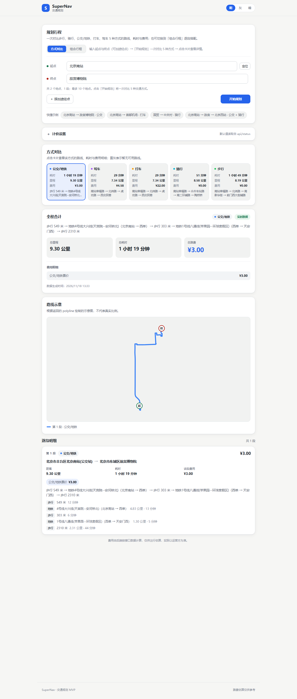
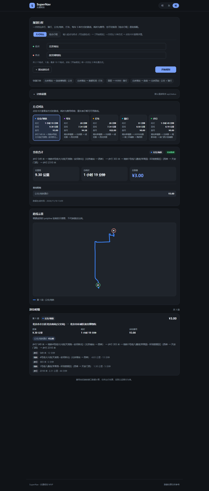
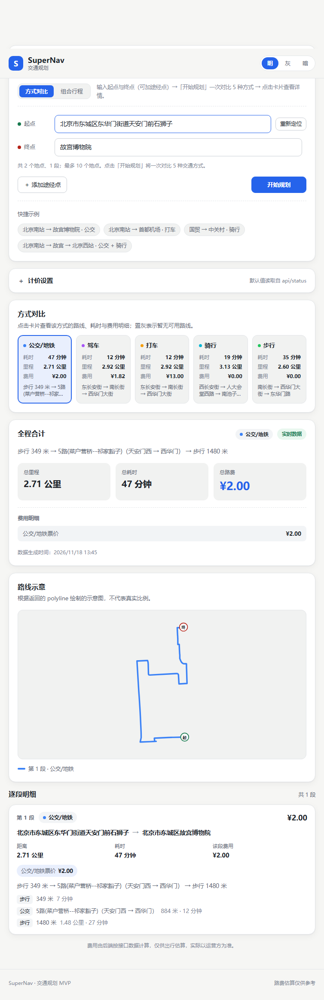

# SuperNav · 交通规划

一个极简的交通规划小应用：输入起点、途经点、终点，**一次对比步行 / 骑行 / 公交地铁 / 打车 / 驾车 5 种方式的路线、耗时与路费**；也可切到「组合行程」为每段单独搭配交通方式并汇总费用。

> 在线体验：**https://wkeeli.cn/supernav/**（公开、无密码；已接入真实高德数据，无 Key 时自动降级演示模式）
> 源码：https://github.com/wzqfwanj/supernav

> 当前版本：MVP v0.4（交通规划：5 方式对比 + 组合行程 + 起点定位）。

## 功能

- **起点定位**：起点支持浏览器定位（「定位」按钮，需 HTTPS / localhost），定位后自动回显详细地址并保存在浏览器本地（刷新后自动恢复）；可随时重新定位或直接编辑地址。
- **方式对比（默认）**：点击「开始规划」一次展示公交/地铁、驾车、打车、骑行、步行 5 种方式的路线、耗时、里程与费用；点击卡片切换查看路线示意、费用明细与逐段详情。
- **组合行程**：切到「组合行程」可逐段选择交通方式（如「公交 → 步行 → 骑行」），按组合计算逐段与全程费用。
- 逐段费用与全程合计：公交票价、打车费、过路费、油费分别展示。
- 明 / 灰 / 暗三种主题，记忆用户选择。
- 高德 Key 未配置时自动进入**演示模式**（模拟数据，界面明确标注），配置后使用真实高德路线。
- 纯 HTML/CSS/JS 前端 + Python(FastAPI) 后端，无前端构建步骤、无外部 CDN。

## 界面预览

线上真实数据（明主题）：



暗主题：



起点定位（回显详细地址，并保存到浏览器本地，刷新后自动恢复）：



## 快速开始

要求：Python 3.10+。

```powershell
# 1. 安装依赖
python -m pip install -r requirements.txt

# 2. 启动（项目根目录）
python -m uvicorn backend.app:app --host 127.0.0.1 --port 8000
# 或 Windows：.\run.ps1

# 3. 浏览器打开
# http://127.0.0.1:8000
```

未配置高德 Key 时即可体验：页面会显示「演示模式」，使用模拟路线与费用。

## 在线地址与部署

- 线上地址：https://wkeeli.cn/supernav/ （公开，无访问密码）
- 部署拓扑：dev 主机 systemd 运行 `supernav.service`（端口 8091），阿里云 Caddy 自动 HTTPS，按子路径 `/supernav/*` 反代。
- 部署/更新步骤见 [deploy/README.md](deploy/README.md)，systemd 单元与 Caddy 片段见 [deploy/](deploy/)。

## 配置高德 Key（切换真实数据）

1. 到 [高德开放平台控制台](https://console.amap.com/dev/key/app) 创建应用，添加 **Web 服务** 类型的 Key。
2. 配置任选其一，二选一即可：
   - 环境变量（推荐）：
     ```powershell
     $env:AMAP_KEY = "你的高德 Web 服务 Key"
     ```
   - 项目根目录新建 `config.local.json`：
     ```json
     {"amap_key": "你的高德 Web 服务 Key"}
     ```
3. 重启服务，页面上的「演示模式」横幅消失即表示已接入真实数据。

> Key 只保存在后端，不会出现在前端代码或响应中。`config.local.json` 已被 `.gitignore` 忽略。

## 计价口径（MVP）

| 方式 | 费用 |
| --- | --- |
| 步行 / 骑行 | 免费（不估算共享单车租金） |
| 公交 / 地铁 | 高德公交规划返回的票价 |
| 打车 | 高德驾车路线返回的预估出租车费用；缺失时按「13 元含 3 公里 + 2.3 元/公里」估算 |
| 驾车 | 油费（里程 × 油耗 × 油价）+ 高德返回的过路费 |

油价、百公里油耗、公交换乘策略可在页面「计价设置」中调整。费用为规划估算值，实际以运营方为准。

## 目录结构

```
backend/          FastAPI 应用、高德客户端、费用计算、演示数据
web/              前端页面（index.html / styles.css / app.js）
docs/             接口契约、界面截图
tests/            后端单元测试
verify/           独立验证脚本与报告（非业务代码）
scripts/          Lead 验收脚本（acceptance.py）
deploy/           systemd 单元、Caddy 子路径反代片段与部署说明
run.ps1           本地启动脚本
config.local.example.json  本地 Key 配置示例
```

接口契约见 [docs/API-CONTRACT.md](docs/API-CONTRACT.md)。

## 测试与验收

```powershell
# 后端单元测试（离线，mock 高德接口）
python -m pytest -q

# 启动服务后做黑盒验收（本地服务；线上同理）
python scripts/acceptance.py

# 独立验证（verifier 输出，含验证报告）
python verify/smoke.py
python verify/dom_check.py
```

## 当前状态

- 后端单测（80 passed）、黑盒验收（59/59）、独立验证（4187 PASS / 0 FAIL，无头 DOM 115 PASS）已通过；页面已用 headless Chrome / Playwright 实际渲染与点击确认（明/暗主题、方式对比、起点定位）。
- 已在线部署：https://wkeeli.cn/supernav/ （子路径反代，无访问密码，公开访问）。
- 已开源：https://github.com/wzqfwanj/supernav （公开仓库，v0.4.0 Release）。
- **真实高德数据已联调**：线上已配置高德 Web 服务 Key，步行 / 骑行 / 公交地铁（含换乘步骤与票价）/ 打车（预估打车费）/ 驾车（油费 + 过路费）均走真实数据；「方式对比」一次调用 5 种方式。
- Key 仅保存在服务器 `/opt/supernav/config.local.json`（权限 600），不进入 Git、不进入前端、不在接口响应中出现；线上保留无 Key 时自动演示模式的降级能力。
- 公开站点调用高德接口受 Key 配额 / QPS 限制；后端已对 QPS 超限做自动退避重试，并在超限时返回可读提示。

## 后续（可选迭代）

- 同一交通方式的多路线方案对比（最快 / 最省）、地图底图、高德 MCP「专属地图/打车唤端」等。
- 线上更新：按 [deploy/README.md](deploy/README.md) 重新打包、部署并 `systemctl restart supernav`（注意保留 `config.local.json`）。

## 技术说明

- 路线规划使用高德 **Web 服务 API**（路径规划 2.0）：`/v5/direction/driving`、`/walking`、`/bicycling`、`/transit/integrated`，地理编码 `/v3/geocode/geo`。与高德 MCP Server 的路径规划能力同源，但直接 HTTP 调用更适合本应用的后端代理与费用计算。
- 本仓库由 Agent Team 并行实现，Lead 集成并验收。
